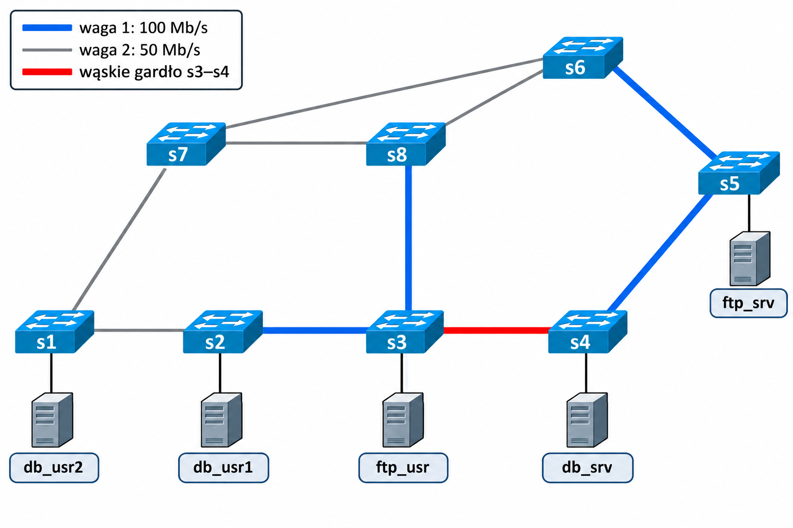

# ssp_projekt – „Bardziej dynamiczny OSPF” w SDN

Projekt realizowany w ramach przedmiotu **Sieci Sterowane Programowo (SSP)**.

## 1. Cel projektu

Klasyczny OSPF wybiera trasy algorytmem Dijkstry na podstawie statycznych kosztów łączy, więc cały ruch idzie najkrótszą ścieżką, nawet gdy jest ona zapchana. Chcemy zbudować w środowisku **Mininet + sterownik SDN (Ryu)** mechanizm, który mierzy zajętość łączy, RTT i przepustowość, a po przekroczeniu progu zajętości wyznacza nową, potencjalnie dłuższą trasę (Dijkstra, porównawczo Bellman-Ford) i instaluje ją w przełącznikach. Ruch testowy generują serwery FTP i HTTPS oraz `iperf3`.

## 2. Literatura

### [1] Cost Adaptive OSPF (CA-OSPF) – artykuł bazowy

Z. Haijun, P. Jin, S. Pubing, „Cost adaptive OSPF”, w: *Proc. 5th Int. Conf. on Computational Intelligence and Multimedia Applications (ICCIMA 2003)*, Xi'an, China, 2003, s. 55–60.
DOI: [10.1109/ICCIMA.2003.1238100](https://doi.org/10.1109/ICCIMA.2003.1238100) · [IEEE Xplore](https://ieeexplore.ieee.org/document/1238100)

Router sam zmienia koszt interfejsu na podstawie zajętości pasma: podnosi go po 3 kolejnych przekroczeniach progu górnego (95%) i obniża poniżej progu dolnego (45%), a każdą zmianę rozsyła w nowym Router-LSA. Z artykułu bierzemy logikę progów z histerezą (reguła `Ub < Ua/2` chroni przed oscylacjami) oraz topologię testową. W naszym projekcie rolę LSA przejmie sterownik SDN, który zna całą topologię i sam przelicza trasy.

```bibtex
@INPROCEEDINGS{1238100,
  author={Zhou Haijun and Pan Jin and Shen Pubing},
  booktitle={Proceedings Fifth International Conference on Computational Intelligence and Multimedia Applications. ICCIMA 2003},
  title={Cost adaptive OSPF},
  year={2003},
  pages={55-60},
  doi={10.1109/ICCIMA.2003.1238100}
}
```

## 3. Topologia – `topo.py`



Topologia odwzorowuje sieć testową z artykułu CA-OSPF: osiem routerów R1–R8 to przełączniki OpenFlow s1–s8, do których podłączono serwery `ftp_srv` i `db_srv` oraz klientów `ftp_usr`, `db_usr1` i `db_usr2`. Wagi OSPF z artykułu zamieniliśmy na przepustowość łączy w Mininecie: łącza o wadze 1 mają 100 Mb/s, a łącza o wadze 2 mają 50 Mb/s. Wąskim gardłem jest łącze s3–s4 (50 Mb/s), przez które przy statycznych kosztach idzie ruch wszystkich trzech klientów, choć istnieją trasy alternatywne s3–s8–s6–s5 oraz s1–s7–s6–s5–s4, na które nasz sterownik ma przenosić ruch po przekroczeniu progu zajętości.

Na razie skrypt używa `OVSController` + STP. STP blokuje pętle, więc trasy alternatywne nie są jeszcze wykorzystywane. Docelowo zastąpi go sterownik Ryu (OpenFlow 1.3).

## 4. Środowisko

| Element | Narzędzie |
|---|---|
| Emulacja sieci | Mininet + Open vSwitch, łącza `TCLink` |
| Sterownik | Ryu (OpenFlow 1.3) |
| Algorytmy grafowe | `networkx` |
| Ruch i pomiary | `iperf3`, `ping`, `curl`, serwery FTP i HTTPS |

## 5. Plan prac

- [x] Literatura: artykuł bazowy CA-OSPF – cytowanie, link, opis przydatności
- [x] Topologia w Mininecie + rysunek
- [ ] Sterownik Ryu: odkrywanie topologii i trasy bazowe (Dijkstra)
- [ ] Moduł pomiarowy: zajętość łączy, RTT
- [ ] Mechanizm progowy z histerezą i instalacja nowych tras
- [ ] Serwery FTP/HTTPS, eksperymenty: statyczny vs. dynamiczny routing
